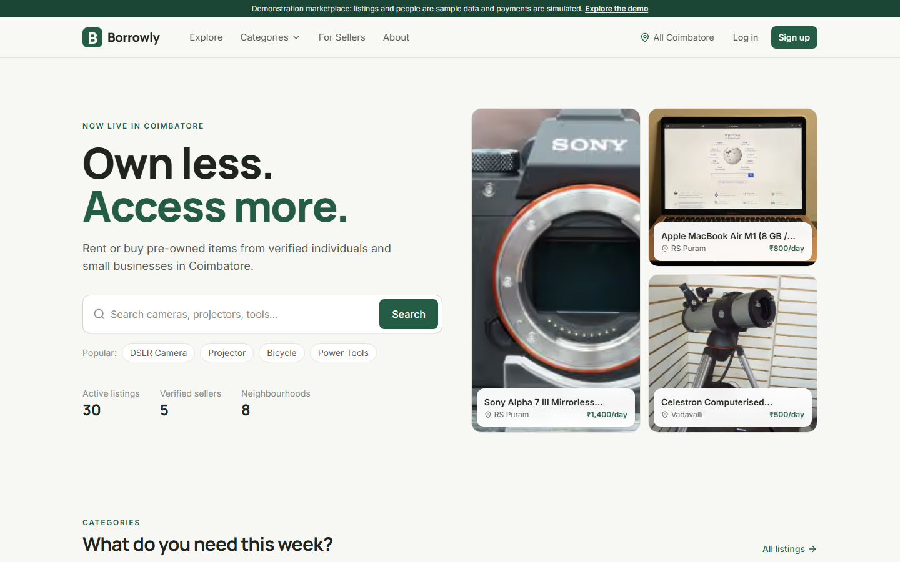
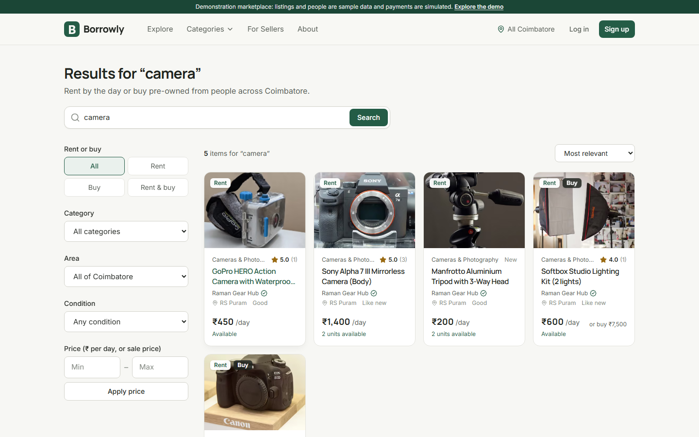
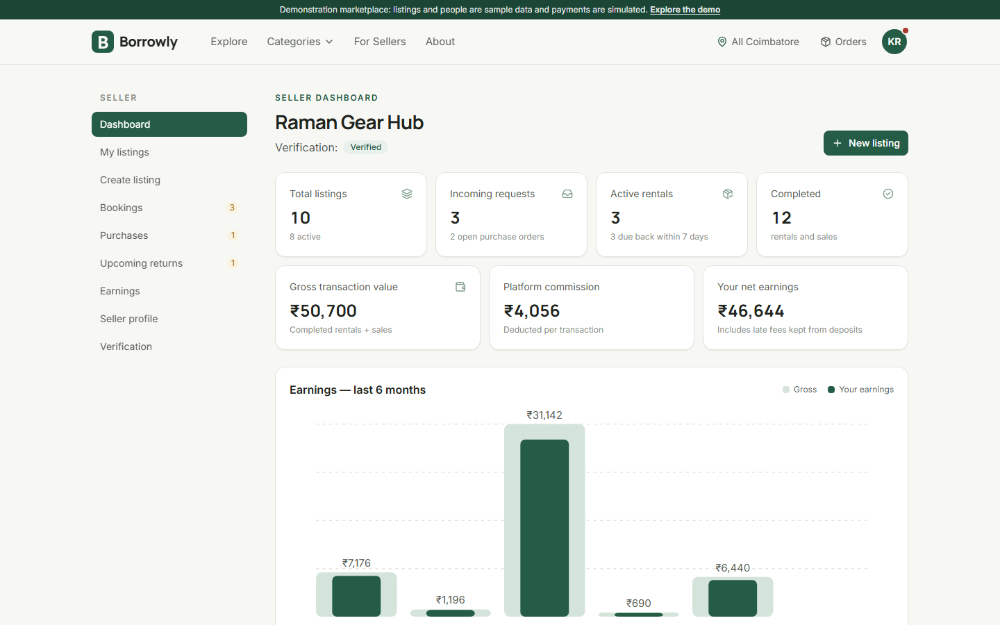
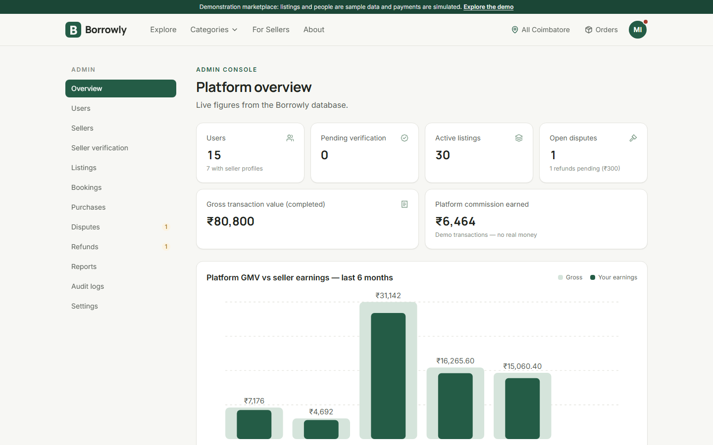

# Borrowly

**Own less. Access more.** A peer-to-peer rental and pre-owned marketplace for Coimbatore, Tamil Nadu.

People rent items by the day or buy them second-hand from verified individuals and small businesses nearby. Sellers turn idle inventory into income. Every booking carries a full record: availability locking, server-side pricing, simulated payment, documented handover and return, reviews and disputes.

**Live demo:** https://borrowly-sigma.vercel.app (open `/demo` for one-click sign-in)

**Solution pitch (Gnani AI challenge):** [PITCH.md](PITCH.md): a one-page overview of the voice features built on Gnani Prisma and Timbre.

> This is a **functional demonstration build**. Listings, people and transactions are seeded sample data, and every payment goes through a simulated provider. No real money moves.



## Features

| Area | What works |
| --- | --- |
| Marketplace | Homepage with live data. Explore and search use PostgreSQL full-text search and relevance ranking. Filters: category, area, condition, rent/buy, price. Sorting and pagination. 9 categories and 38 listings with real photos. Product gallery, seller profiles, favourites, location selector. |
| Rentals | Calendar with live per-day availability. Server-side quote. 15-minute checkout holds. Row-locked inventory, so double booking is impossible. Idempotent checkout. Seller confirm/decline, two-party handover and return with immutable evidence, late-return fees, deposit release. |
| Purchases | Atomic stock reservation (a single unit sells exactly once). Sold-out handling, restock on payment failure or cancellation, accept, handover, receipt. |
| Payments | Provider abstraction with a simulated provider: approve or decline, plus `CREATED / PENDING / SUCCESS / FAILED / REFUND_PENDING / REFUNDED` states, refunds and transaction history. All amounts are integer paise. |
| Trust | Seller verification (email, phone OTP via a dev outbox, admin review; no ID documents), reviews only after completed transactions (one per transaction), disputes with evidence and admin resolution, audit log. |
| Dashboards | **Customer:** bookings, purchases, favourites, notifications, disputes, transactions, profile. **Seller:** KPIs, earnings chart from real data, listings, a 7-step listing wizard with photo upload, bookings, orders, returns, verification. **Admin:** overview, users, sellers, verification queue, listing moderation, bookings, purchases, disputes, refunds, reports, audit logs, configurable commission, demo reset. |
| Security | Database-backed sessions in httpOnly cookies, bcrypt, server-side role and ownership checks on every action, Zod validation, rate limiting, magic-byte upload validation with re-encoding, private evidence served through authorization, security headers. See [SECURITY.md](SECURITY.md). |

## Borrowly Voice (Gnani AI)

Borrowly lets people rent, list and record handovers by **speaking Tamil, Tanglish or English**, using Gnani AI's Indian-language speech models. See `/voice` on the site.

| Feature | Gnani model | Where |
| --- | --- | --- |
| Voice search: *"Naalaiku oru DSLR camera venum, RS Puram la"* becomes item, area and dates, with the dates pre-selected on the booking calendar | **Prisma v3.0** STT (`ta-IN,en-IN`, code-mix) | mic in every search bar |
| Speak to list: a spoken description fills brand, category, condition and prices | **Prisma v3.0** STT | Seller → Create listing |
| Spoken replies in Tamil for search results and booking summaries (numbers said as Tamil words) | **Timbre v3.0** TTS (`ta-IN`) | Explore after a voice search; booking page |
| Voice handover and return notes, saved as tamper-proof evidence | **Prisma v3.0** STT | Booking → handover / return step |

- **How it works:** the browser records 16 kHz WAV and Borrowly's server calls `api.vachana.ai`, so the key never reaches the client. A deterministic parser (`src/modules/voice/understand.ts`) understands Tamil script, romanised Tanglish, number words ("rendu aayiram"), relative dates ("naalaiku") and Coimbatore areas. Spoken replies are composed on the server from live data and cached.
- **Setup:** set `GNANI_API_KEY` in `.env` (create one at app.gnani.ai/voice).
- **Live check** (spends a few credits): `npx tsx --env-file=.env scripts/voice-smoke.ts`.
- **Contest:** the submission kit is in [docs/GNANI_SUBMISSION.md](docs/GNANI_SUBMISSION.md).

## Tech stack

Next.js 16 (App Router, Server Actions) · React 19 · TypeScript · Tailwind CSS 4 · Lucide · PostgreSQL · Prisma 6 · Zod 4 · React Hook Form · Vitest · Playwright · embedded-postgres (local dev) · Supabase-ready storage adapter · Vercel-ready.

The app is a **modular monolith**: business rules live in `src/modules/*` as framework-independent services, and pages, server actions and API routes are thin adapters over them. See [ARCHITECTURE.md](ARCHITECTURE.md).

## Quick start (local)

Prerequisites: **Node.js 20+**. No Docker or system PostgreSQL is needed: `npm run db:local` runs a real PostgreSQL 17 server from the `embedded-postgres` npm package (installed by `npm install`).

```bash
git clone https://github.com/subii13/Borrowly-.git
cd Borrowly-
npm install
cp .env.example .env
```

Terminal 1, the database (keep it running):

```bash
npm run db:local
```

Terminal 2:

```bash
npx prisma migrate deploy
npm run db:seed
npm run dev
```

Open http://localhost:3000 and click **Explore the demo**.

> Already have PostgreSQL (or Supabase)? Skip `db:local` and set `DATABASE_URL` / `DIRECT_URL` in `.env`.

## Demo accounts

Development and demo only. All three use the password **`Borrowly@Demo2026`**.

| Role | Email | Lands on | Try |
| --- | --- | --- | --- |
| Customer | `customer@borrowly.demo` | `/account` | Rent the projector, confirm receipt of the Raspberry Pi, review the tripod rental |
| Seller | `seller@borrowly.demo` | `/seller` | Confirm requests, record handover and returns, create a listing |
| Admin | `admin@borrowly.demo` | `/admin` | Approve a seller, resolve disputes, process the pending refund |

With `DEMO_MODE=true`, the `/demo` page and the login page offer one-click sign-in for these accounts. The full walkthrough is in [DEMO_GUIDE.md](DEMO_GUIDE.md).

**Reset the demo data:** run `npm run db:seed` locally, or as admin use **Settings → Reset demo data** (only when `DEMO_MODE=true`).

## Commands

| Command | Purpose |
| --- | --- |
| `npm run dev` | Start the dev server |
| `npm run build` / `npm start` | Production build / serve |
| `npm run db:local` | Run local PostgreSQL (port 5433) |
| `npx prisma migrate deploy` | Apply migrations |
| `npm run db:seed` | Reset the database to the demo dataset |
| `npm test` | Vitest unit + integration tests (needs the database running) |
| `npm run test:e2e` | Playwright end-to-end workflows |
| `npm run typecheck` | TypeScript check |
| `npm run images:fetch` | Re-download the licensed demo photos (Wikimedia Commons) |

## Testing

- **49 Vitest tests:** 24 unit, plus 25 integration tests against a real PostgreSQL test database. They cover pricing, half-open date overlap, concurrent double-booking prevention, hold expiry, idempotency races, sold-out races, payment failure, cancellation and refunds, the full rental lifecycle, reviews, disputes, auth, ownership and admin authorization, upload validation, and SQL-injection-safe search.
- **Playwright** covers the customer rental, customer purchase, declined payment, seller and admin workflows, plus a mobile overflow check (8/8 passing on a production build).

Commands and actual results are in [TESTING.md](TESTING.md).

## Documentation

- [PROJECT_SPEC.md](PROJECT_SPEC.md): product and functional requirements
- [ARCHITECTURE.md](ARCHITECTURE.md): modules, request flow, API
- [DATABASE_DESIGN.md](DATABASE_DESIGN.md): schema, relations, indexes, business rules
- [SECURITY.md](SECURITY.md): authentication, authorization, controls, known limits
- [TESTING.md](TESTING.md): test plan and results
- [DEPLOYMENT.md](DEPLOYMENT.md): Vercel + Supabase deployment
- [DEMO_GUIDE.md](DEMO_GUIDE.md): guided demo for each role
- [DEVELOPMENT_PLAN.md](DEVELOPMENT_PLAN.md): phases, status and future work

## Screenshots

| | |
| --- | --- |
|  |  |
|  |  |

## Image credits

Demo photos are from Wikimedia Commons under CC0, public domain, CC BY or CC BY-SA licences. Each one's attribution is in `public/images/credits.json` and on the `/credits` page.
